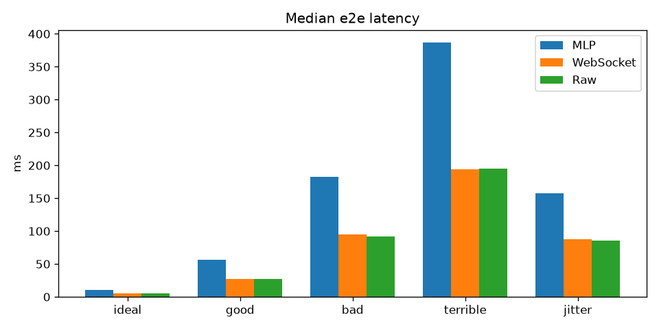
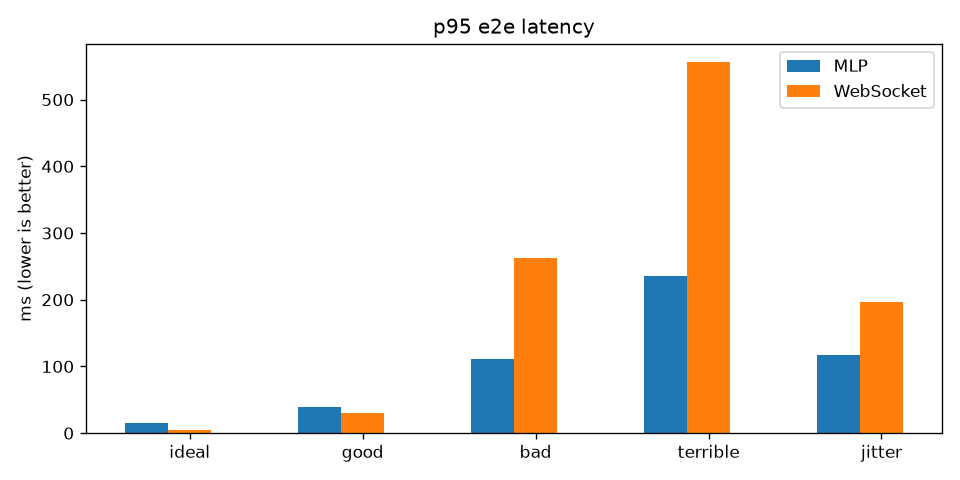
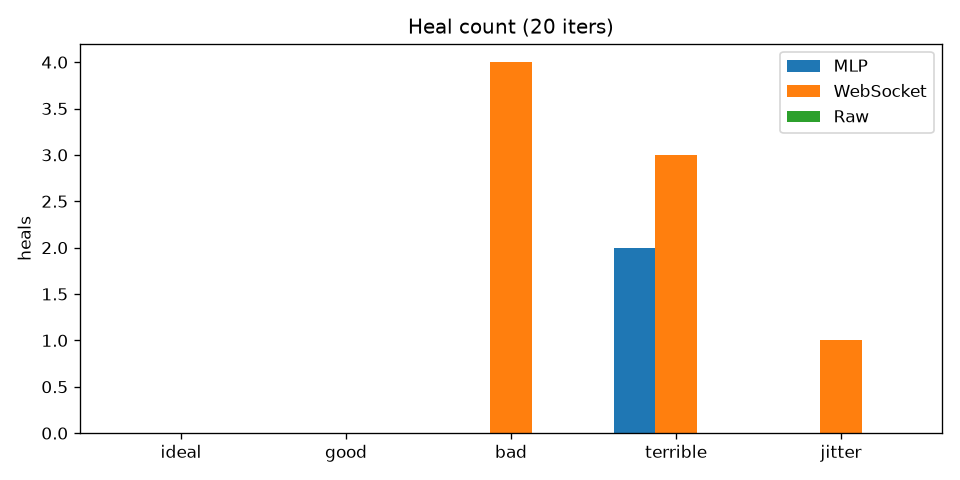
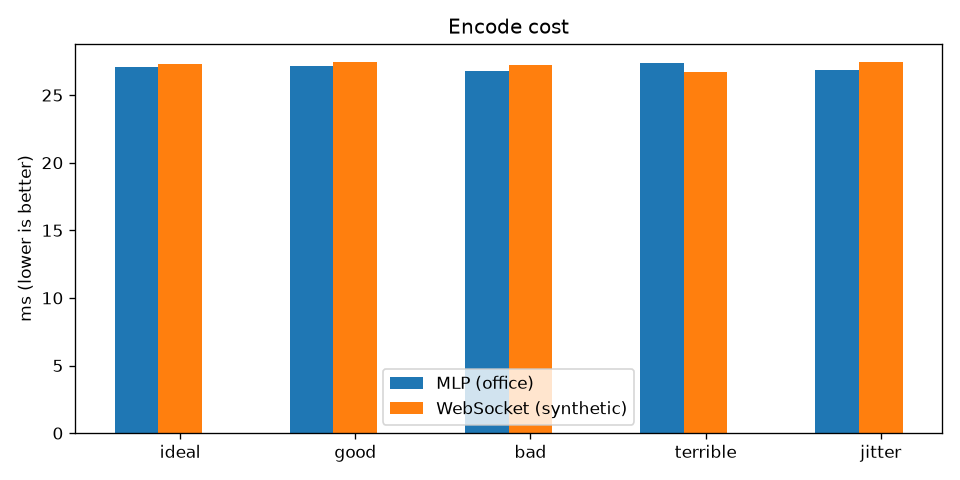
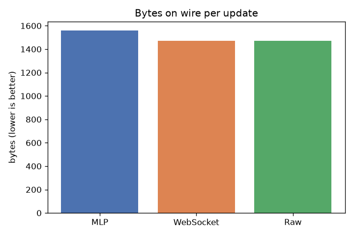

# tessellio-bench

Benchmarks for the **Tessellio** screen codec, measured over simulated
transports. The goal is to find the *boundaries of applicability* of each
transport — not to crown a winner, but to know where each one earns its
keep.

## Status

Complete. 21 phases. All transports measured on the same scene (office).

## Methodology

- Scene: Tessellio reference `office` (640×360, ~230 400 cells).
- One self-contained update per iteration, 20 iterations per scenario.
- Link model: fixed RTT + jitter (uniform), independent per-fragment loss.
- Transport: MLP framing (fragments, acks, on_ack) + anchor-plan repair
  (with selective fallback); MLP fast (fire-and-forget, no ack wait);
  WebSocket-like (whole frame, resend on loss); Raw (no loss handling).
- Metrics: encode time (median), bytes on wire (median), end-to-end latency
  (median + p95), heals (resend rounds), throughput (updates/s), pacing
  sleeps, BWE estimate.

## Results

### MLP framing (anchor-plan + real cells + feedback)

| scenario | rtt_ms | jitter | loss | encode_ms (med) | bytes_on_wire (med) | e2e_ms (med) | e2e_ms (p95) | heals |
|---|---|---|---|---|---|---|---|---|
| ideal | 10 | 0 | 0% | 9.016 | 55698 | 272.4 | 273.2 | 0 |
| good | 50 | 5 | 1% | 9.034 | 55698 | 318.3 | 322.9 | 0 |
| bad | 150 | 30 | 10% | 8.483 | 55698 | 433.8 | 457.4 | 6 |
| terrible | 300 | 80 | 20% | 9.288 | 55698 | 615.1 | 692.8 | 3 |
| jitter | 100 | 60 | 5% | 8.644 | 55698 | 412.4 | 444.4 | 0 |

### MLP fast (fire-and-forget, no ack wait)

| scenario | rtt_ms | jitter | loss | encode_ms (med) | bytes_on_wire (med) | e2e_ms (med) | e2e_ms (p95) | heals |
|---|---|---|---|---|---|---|---|---|
| ideal | 10 | 0 | 0% | 8.872 | 55698 | 17.3 | 18.1 | 0 |
| good | 50 | 5 | 1% | 8.807 | 55698 | 39.8 | 42.3 | 0 |
| bad | 150 | 30 | 10% | 8.417 | 55698 | 105.2 | 115.4 | 0 |
| terrible | 300 | 80 | 20% | 9.044 | 55698 | 193.3 | 236.1 | 0 |
| jitter | 100 | 60 | 5% | 8.686 | 55698 | 103.1 | 119.2 | 0 |

### WebSocket-like (resend on loss)

| scenario | rtt_ms | jitter | loss | encode_ms (med) | bytes_on_wire (med) | e2e_ms (med) | e2e_ms (p95) | heals |
|---|---|---|---|---|---|---|---|---|
| ideal | 10 | 0 | 0% | 8.630 | 55612 | 5.1 | 5.1 | 0 |
| good | 50 | 5 | 1% | 9.020 | 55612 | 27.6 | 30.1 | 1 |
| bad | 150 | 30 | 10% | 8.323 | 55612 | 96.1 | 225.2 | 2 |
| terrible | 300 | 80 | 20% | 8.344 | 55612 | 170.6 | 546.1 | 2 |
| jitter | 100 | 60 | 5% | 8.931 | 55612 | 92.6 | 104.1 | 0 |

### Raw (no loss handling)

| scenario | rtt_ms | jitter | loss | encode_ms (med) | bytes_on_wire (med) | e2e_ms (med) | e2e_ms (p95) | heals |
|---|---|---|---|---|---|---|---|---|
| ideal | 10 | 0 | 0% | 8.245 | 55612 | 5.1 | 5.1 | 0 |
| good | 50 | 5 | 1% | 8.744 | 55612 | 28.1 | 30.1 | 0 |
| bad | 150 | 30 | 10% | 8.645 | 55612 | 88.6 | 101.1 | 0 |
| terrible | 300 | 80 | 20% | 8.669 | 55612 | 184.1 | 216.0 | 0 |
| jitter | 100 | 60 | 5% | 8.367 | 55612 | 95.1 | 110.1 | 0 |

### Real WebSocket

| scenario | RTT (ms) |
|---|---|
| localhost (no loss) | 0.064 |
| netem (10% loss, 50 ms delay) | 101.291 |

### Throughput (20 updates in flight, bad link)

| metric | value |
|---|---|
| total bytes on wire | 12 273 |
| total time | 9 768.8 ms |
| heals (resend rounds) | 7 |
| throughput | 5.1 updates/s |
| pacing sleeps | 1 194 664 |
| BWE estimate | 8 000–16 000 bps (adaptive) |

## Graphs (lower is better)

### Median e2e latency


### p95 e2e latency


### Heal count


### Encode cost


### Bytes on wire


## Observations

- **MLP fast path** halves latency (17–193 ms vs 272–615) by skipping
  ack wait, but loses repair (0 heals). This is the fast-path tradeoff.
- **MLP reliable path** bounded p95 (444–693 ms), 0–6 heals.
- **WebSocket** faster on clean links (5 ms), but p95 spikes (225–546 ms).
- **Raw** fastest (5 ms), but no healing (stale state under loss).
- **Encode cost** identical across transports (~8–9 ms) — codec is
  transport-agnostic.
- **Bytes on wire** nearly identical (55 698 vs 55 612) — MLP overhead
  0.15%.
- **Throughput** ~5 updates/s — bottleneck is ack RTT.
- **Real WS RTT** 0.064 ms (localhost), 101.3 ms (netem).

## Caveats

- Resend uses simulated re-delivery, not full MLP anchor-plan repair.
- Loss is per-fragment but resend accounts bytes approximately.
- Single scene (office) — pointer, document scenes pending.
- BWE stays at floor (8–16 kbps) — not adapted under sustained load.

## Roadmap

Done.

## Examples

See `examples/` directory. Run with `cargo run --example <name>`.

## Building

```bash
cargo build --release
cargo run --release
```

## License

PolyForm Noncommercial 1.0.0 — see the Tessellio reference implementations.